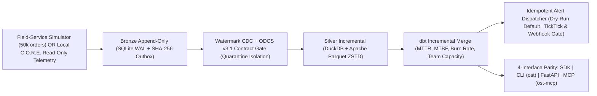

# Ops SLA Telemetry Lakehouse

Event-driven field-service and operational SLA telemetry lakehouse: incremental CDC, 99% SLA error-budget burn rate, MTTR/MTBF analytics, and automated alert dispatch (`Python`, `DuckDB`, `dbt`, `Parquet`, `FastAPI`, `MCP`).

---

## 1. Architecture Overview



### Design Pillars

1. **Idempotent Event Sourcing & Watermark CDC ([ADR-001](docs/adr/ADR-001-event-sourcing-idempotent-cdc.md)):**
   - Append-only Bronze storage in `SQLite WAL` with `SHA-256` batch outbox manifests and `event_id` deduplication.
   - Ingestion-watermark `CdcEventIngestor` capturing late-arriving and out-of-order events into atomic `ZSTD` Parquet Silver slices via DuckDB.
   - `ODCS v3.1` contract validation isolating malformed events into `data/quarantine/`.
2. **Dual-Calendar SLA Mathematics & SRE Burn Rate ([ADR-002](docs/adr/ADR-002-sla-mathematics-burn-rate-windows.md)):**
   - Continuous `24x7` calendar (`4h` SLA) for critical `P1/EMERGENCY` field orders vs. business-hours calendar (`Mon-Fri 08:00-18:00 America/Manaus`, excluding national holidays) for `P2` (`24h`) and `P3` (`72h`), discounting validated `ON_HOLD` intervals.
   - `99.0%` global SLO (`1.0%` error budget) with Google SRE multi-window burn-rate pairs (`1h/6h`, `6h/24h`, `24h/7d` mapped to `SEV-1..SEV-4`) plus `MTTR` and `MTBF` team analytics.
3. **Zero-Trust Multi-Repo Privacy Boundary ([ADR-003](docs/adr/ADR-003-multi-repo-privacy-boundary.md)):**
   - Public repository executes strictly on deterministic synthetic datasets (`seed=42`).
   - Local read-only C.O.R.E. collectors enforce closed per-source field allowlists and write real local snapshots exclusively outside this repository tree (`core/.logs/ops_sla_telemetry/`).
   - External alert dispatch defaults to `--dry-run`, enforces incident deduplication and alert ceilings, and requires explicit human confirmation (`--execute --confirm`).

---

## 2. Local Setup & Verification

```bash
python -m venv .venv
source .venv/bin/activate  # Windows PowerShell: .\.venv\Scripts\Activate.ps1
pip install -r requirements.txt -r requirements-dev.txt
pip install --no-deps -e .

# Lint, deterministic catalog/progress checks, and offline test suite
ruff check .
python scripts/render_catalog.py --check
python scripts/render_progress.py --check
pytest -m "not live" -v

# CLI foundation check
ost --version
ost status --json
```

### Quick Usage (`CLI`, `Python SDK`, `FastAPI`, `MCP`)

```bash
# 1. Generate 50,000 synthetic orders -> Bronze SQLite WAL -> Silver ZSTD Parquet -> dbt Gold marts
ost ingest --seed 42 --orders 50000
ost sla-status --json
ost at-risk --limit 10
ost team-capacity --limit 10
ost core-health
ost sync-ticktick   # Defaults strictly to --dry-run

# 2. FastAPI REST API (OpenAPI docs at /docs)
uvicorn ops_sla_telemetry.api.app:create_app --factory --reload

# 3. Stdio MCP Server (JSON-RPC 2.0 with <untrusted_data> wrapping)
ost-mcp
```

```python
from ops_sla_telemetry import OpsSlaTelemetry

sdk = OpsSlaTelemetry()
sdk.ingest(seed=42, order_count=50_000, run_dbt=True)
print(sdk.sla_status()["global_summary"])
print(sdk.sync_ticktick())  # dry-run by default
```

---

## 3. Repository Map

| Path | Purpose |
| :--- | :--- |
| [`docs/adr/`](docs/adr/) | Architecture Decision Records (`ADR-001` through `ADR-003`) |
| [`catalog/events_and_slas.yaml`](catalog/events_and_slas.yaml) & [`CATALOG.md`](CATALOG.md) | Single source of truth for event schemas, SLA policies, and burn-rate thresholds |
| [`state/project_progress.json`](state/project_progress.json) & [`JORNADA_IMPLEMENTACAO.md`](JORNADA_IMPLEMENTACAO.md) | Phase tracker and acceptance gates (`Phase 00` through `Phase 08`) |
| [`scripts/`](scripts/) | Deterministic renderers (`render_catalog.py`, `render_progress.py`) and dbt docs linter (`lint_dbt_docs.py`) |
| [`src/ops_sla_telemetry/`](src/ops_sla_telemetry/) | Core Python SDK (`OpsSlaTelemetry`), simulator, CDC ingestor, collectors, dispatcher, CLI (`ost`), FastAPI (`/api/v1/*`), and MCP (`ost-mcp`) |
| [`dbt/`](dbt/) | DuckDB incremental models (`stg_service_events` -> `int_order_lifecycle_spans` -> `fct_service_order_sla`, `fct_team_daily_capacity`, `mart_sla_burn_rate_alerts`) |
| [`.github/workflows/`](.github/workflows/) | CI quality checks (`ci.yml`) and PR governance linting (`pr-lint.yml`) |
| [`tests/`](tests/) | Deterministic offline verification suite (`pytest -m "not live"`) |
